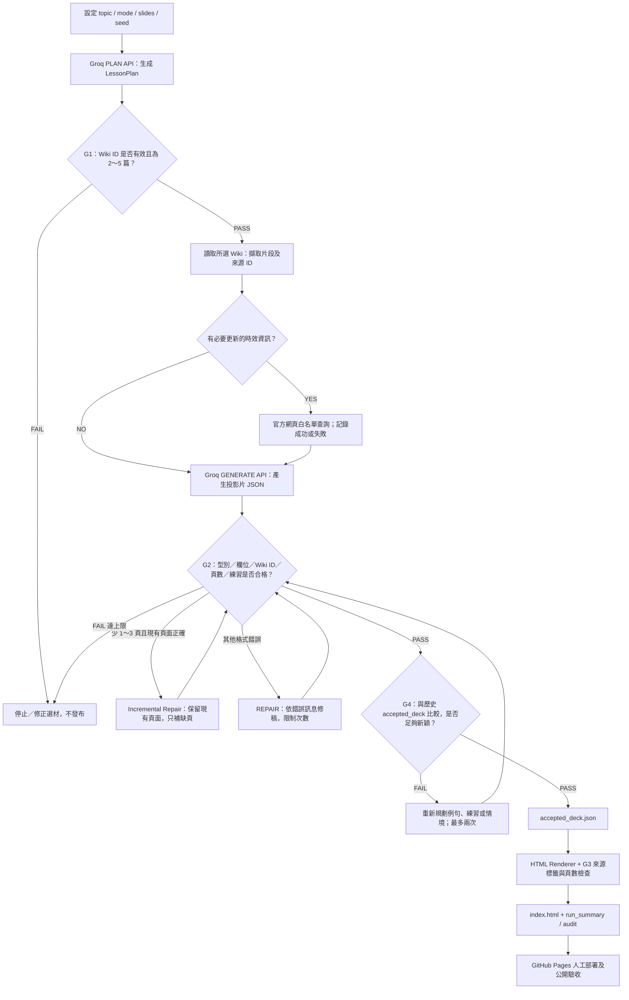

# WBS-07B｜Loop / Graph 設計與執行邊界

## 目標

使用七篇德語 A2 Wiki 為知識來源，經 Google Colab 與 Groq API **規劃教案、動態選材、生成教學 HTML**，將結構錯誤與跨輪重複攔截於發布前。

## 各節點可追溯性

| 節點 | 程式／Notebook 位置 | 實際作用 | FAIL 策略 |
|---|---|---|---|
| PLAN | v3.7 §06 | 真實 Groq `chat/completions` 呼叫，產生課程規劃與 Wiki 選材 | API 錯誤停止或按 429 訊息退避 |
| G1 | §06 | 僅允許 7 篇 Wiki 的有效 ID，並控制選取數量 | 不讓無效選材進入生成 |
| RETRIEVE | §07 | 從 Markdown 擷取所選 Wiki 證據，保存 `retrieved_wiki.json` | 來源不足時停下修正 |
| REFRESH | §08 | 若計畫要求最新情境，向白名單官方網站擷取；擷取失敗不宣稱更新成功 | `BLOCKED`，沿用穩定教學內容 |
| GENERATE | §09 | 真實 Groq API 生成動態投影片 JSON | 先檢查型別，不直接 `.get()` 假設正確 |
| G2 | §10 | 檢查 JSON 結構、頁數、Wiki ID、德語例句及練習 | 缺頁優先增量補頁；其它問題修復迴圈 |
| G4 | §10 | 與歷史已接受課程比較標題、例句、練習；新穎性不足則重生 | 最多 2 次；仍失敗 STOP |
| RENDER / G3 | §11 | 渲染 HTML 並檢查滑頁與 Wiki 標記數 | 不合格不作正式交付 |
| RECORD | §12～13 | 報告與 ZIP：`audit.json`、`novelty_report.json`、`run_summary.json` | 留下可回溯證據 |

## 教學設計理由

- **來源先行**：先做 Wiki 選材與引用，避免模型完全自由發揮。
- **檢查前移**：在 HTML 生成前檢查 JSON 格式、頁數與來源標籤，減少無效頁面。
- **最小修復**：9/10 頁應只補 1 頁，避免重生 10 頁造成 Token 浪費與速率限制。
- **跨輪比較**：不同主題／不同 Run ID 不必然等於教材不同；要檢查具體例句與練習。
- **公開與生成分離**：Groq API 於 Colab 執行，GitHub Pages 展示當輪驗收後靜態 HTML，不在公開頁面執行 API。

**重要限制**：G2 是結構與形式檢查，不是獨立德語教師審校；G4 是文字層級的新穎性比較，不能保證 70 輪均提供完全新穎的教學成果。
